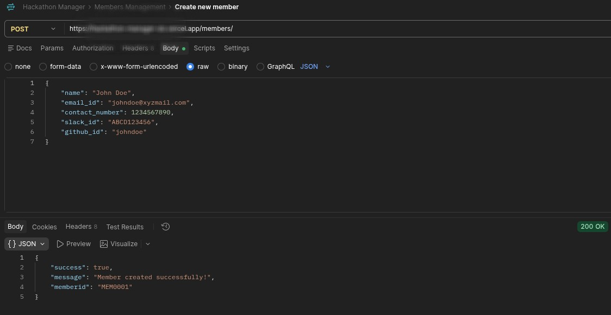
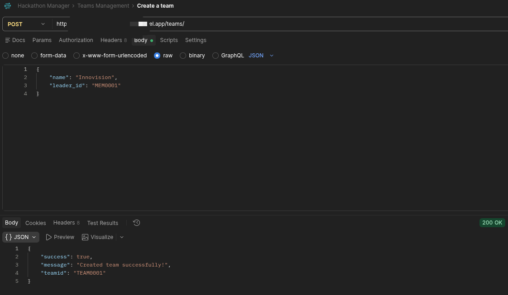
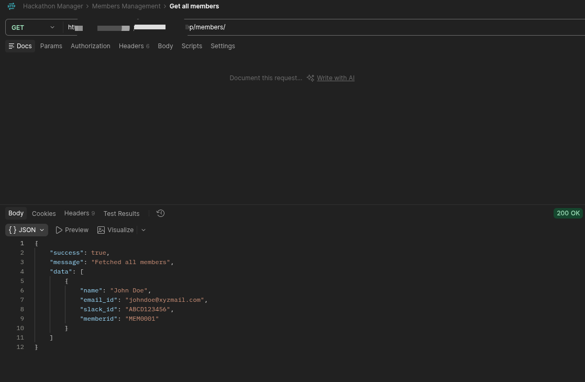
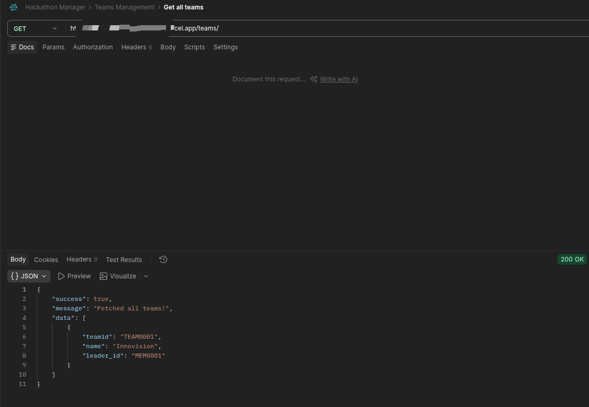

# Hackathon Manager
Hackathon Manager is an open-source API used for basic CRUD operations while managing a hackathon.

## Project Overview
Hackathon manager is used to simplify the management of a Hackathon using REST API. Instead of manually taking records of members, teams, projects, and judgements it can be used as a system.

## Use Cases
Hackathon Manager can be used by:

- **Organisers**: to manage registerations, participants and teams.
- **Participants**: Manage team and project information.
- **Judges**: Pass judgements, request changes in projects or reject them.

## Features
The features of this system includes:
- Member Management
- Team Management
- Project Management
- Judgement Management

Details and endpoints of these features can be found at [FEATURES.md](/FEATURES.md)

## Screenshots
There are screenshots of top 4 requests I personally like, you can see more info in [FEATURES.md](/FEATURES.md).









The request URL is blurred because it is hosted URL with my database linked to it, I'll soon unhost it and put the postman collection link!

## Tech Stack
The system is build using **Python** and **FastAPI**. It uses **MongoDB** as database.

## Running the Project
1. Clone the repository
```bash
git clone https://github.com/hasancooksfr/hackathon-manager
cd hackathon-manager
```

2. Install dependencies
```bash
pip install -r requirements.txt
```

3. Configure environment variables
Create an `.env` file:
```env
MONGO_URI=your_mongo_uri_string
```

4. Start the server
```bash
uvicorn main:app --reload
```

The API will be available at:
```
http://127.0.0.1:8000
```

## Database
This system uses  **MongoDB** for data storage.

The system currently uses different collections for different features, including:
```
members
teams
projects
```

## Endpoint prefixes
For each feature, there is an different prefix endpoint:
```
Members: /members
Teams: /teams
Projects: /projects
Judgement: /judgement
```

## Future improvements

Some features I would work on in future:

- Authentication and role-based access.
- Improved validation and error handling.
- A frontend webapp connected with this API
- More advanced project evaluation and judgement.

## Contributing

Contributions are welcome! If you find a bug, have an idea for improvement, or want to add a new feature, feel free to open an issue or submit a PR request.

Please make sure your features are tested before submitting.

## License
This project is licenced under MIT License.